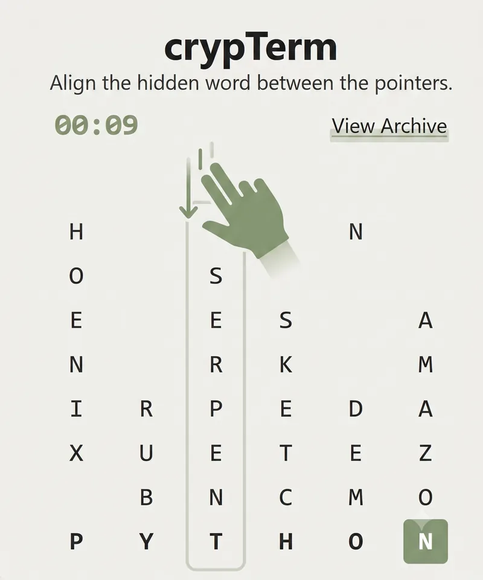

# crypTerm

A mobile-friendly, daily word puzzle: six columns of a cryptex, one hidden word
hiding between the pointers.



## How to Play

- Each vertical column contains letters. They all relate to the code word in some way.
- Swipe or use the D-Pad controls to shift columns up and down.
- Align the hidden horizontal target word inside the active center row.
- Use the **Hint** button if you get stuck.

## Tech Stack

- **Backend:** Python / Flask, [Datamuse API](https://www.datamuse.com/api/)
- **Database:** Cloudflare D1 (SQLite), reached through a small Cloudflare Worker that
  exposes a parameterised SQL endpoint (`D1_API_URL` / `D1_API_SECRET`)
- **Frontend:** HTMX, Pico.css, Vanilla JavaScript
- **Animations:** Canvas Confetti

## How it works

- the Datamuse API is asked for a random, reasonably common English word between
  4 and 8 letters long; that word is the answer
- more Datamuse calls (`ml`, `rel_syn`, `rel_trg`) build a bucket of related words
- the generator then looks for a set of column words where one letter of each
  column word matches one letter of the theme word, in order
- if that fails, it asks Datamuse again with a new theme word (bounded retries)
- candidates are ranked by popularity and fit, so the columns aren't obscure
  words with a barely-there connection
- the winning set of words is stored as a grid and saved to D1 for that date
- every column spin sends one request: "does this match the hidden word?".
  A match fires the confetti and opens the win screen, which reveals the answer
  and shows which letter of each column word it was hiding in.
- the hint button rotates the active column until its letter lands under the
  pointer, then puts itself on a 5 second cooldown. Hints are tracked so the
  shared result marks hinted columns yellow.

## Running Locally

1. Clone the repository:
   ```bash
   git clone https://github.com/AkiTheLucky/crypt_term_flask.git
   cd crypt_term_flask
   ```
2. Create a virtual environment and install dependencies:
   ```bash
   python -m venv .venv
   .venv\Scripts\activate      # Windows
   # source .venv/bin/activate # macOS / Linux
   pip install -r requirements.txt
   ```
3. Set the environment variables (see below), then:
   ```bash
   python app.py
   ```
4. Open <http://127.0.0.1:5000>.

## Environment Variables

| Variable        | Required | Purpose                                                        |
| --------------- | -------- | -------------------------------------------------------------- |
| `SECRET_KEY`    | yes      | Flask session signing key. Must stay stable across restarts.   |
| `D1_API_URL`    | yes      | URL of the Cloudflare Worker that proxies SQL to D1.           |
| `D1_API_SECRET` | yes      | Bearer token for that Worker.                                  |

Generate a key with `python -c "import secrets; print(secrets.token_hex(32))"`.
Without `SECRET_KEY` the app falls back to a random key per process, which means
sessions (and therefore an in-progress puzzle) break on every restart.

## Deployment

The live instance runs on Render behind Cloudflare. Start command:

```bash
gunicorn app:app
```

All three environment variables above must be set in the Render dashboard.

## Database

Two tables are expected in D1:

```sql
CREATE TABLE puzzle (
    id          INTEGER PRIMARY KEY AUTOINCREMENT,
    play_date   TEXT NOT NULL,
    theme_word  TEXT NOT NULL,
    matrix_json TEXT NOT NULL
);

CREATE UNIQUE INDEX IF NOT EXISTS idx_puzzle_play_date ON puzzle(play_date);

CREATE TABLE score (
    id              INTEGER PRIMARY KEY AUTOINCREMENT,
    puzzle_date     TEXT NOT NULL,
    nickname        TEXT NOT NULL,
    time_in_seconds INTEGER NOT NULL
);
```

The unique index matters: without it, two visitors arriving at midnight at the
same moment can each generate and store a puzzle for the same date. The app
creates it on first use and stays consistent even if that fails (every read
orders by `id` and takes the first row), but creating it up front is better.
